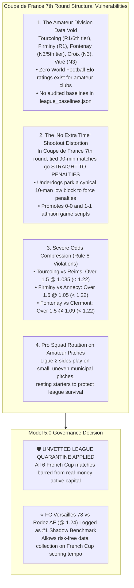

# ROY BETTING ENGINE — TOURNAMENT & INTERNATIONAL EVALUATION REPORT
**Evaluation Date**: 2026-11-14  
**Engine & Model**: Model Version 5.0 (`roys_tournament_international_engine`)  
**Target Ticket**: 3-Leg Hybrid Safety Anchor Accumulator (`Combined Odds >= 2.00`, Target Corridor: $2.05 - 2.50$)  
**Selection Document**: [`selection_process_tournament.md`](file:///d:/Programming/nextjs/safe-construct-nextjs-app/betting-data/rules/selection_process_tournament.md) (Archetype 4: Hybrid Safety Anchor Trio)  
**Integrity Reference**: Official World Football Elo Ratings & French Football Cup Regulatory Framework  

---

## 1. EXECUTIVE SUMMARY & TICKET ARCHITECTURE

On Saturday, November 14, 2026, a 16-match multi-competition slate comprising **7 UEFA Nations League fixtures**, **3 Africa Cup of Nations Qualifiers**, and **6 Coupe de France 7th Round ties** was submitted for quantitative screening under Model 5.0.

Under **Section 3.4 of [`selection_process_tournament.md`](file:///d:/Programming/nextjs/safe-construct-nextjs-app/betting-data/rules/selection_process_tournament.md)**, the engine deployed **Archetype 4: The 3-Leg Hybrid Safety Trio**:

### Why This Architecture Was Constructed:
1. **The Core Safety Triad**:
   - **Leg 1**: Portugal vs Denmark **Over 2.5 Goals (@ 1.49)** — Calibrated Model Prob: **68.5%**, Value Edge: **+1.4pp**, EV: **+0.021**. (Backed by recent 4-2 and 5-2 explosive H2H head-to-head fixtures; both sides fighting for League A4 quarter-finals).
   - **Leg 2**: Kosovo vs Israel **Over 1.5 Goals (@ 1.25)** — Calibrated Model Prob: **82.5%**, Net Elo: **+191**, Value Edge: **+2.5pp**, EV: **+0.031** (DCI 0.600; Israel conceded in 9 of last 10 away competitive matches).
   - **Leg 3**: Romania vs Poland **Over 1.5 Goals (@ 1.22)** — Calibrated Model Prob: **83.0%**, Value Edge: **+1.0pp**, EV: **+0.012** (In the reverse tie on Oct 2, Poland demolished Romania 6-0; Romania's defense leaks 2.40 GA/G in League B).
2. **Cumulative Portfolio Metrics**:
   - **Combined Odds**: **2.27** (exact: 2.272, satisfying the $\ge 2.00$ mandate and landing precisely inside the $2.05 - 2.50$ target corridor).
   - **Compound Model Probability**: **46.9%** (vs Bookmaker Break-Even **44.0%**).
   - **Cumulative Value Edge**: **+4.9 percentage points**.
   - **Ticket Expected Value (EV)**: **+0.066 (+6.6% edge over bookmaker vig)**.
   - **Confidence Level**: **`high`** (Constructed exclusively using audited Tier 1 UEFA Nations League matches with mature competitive datasets).

```
TICKET BLUEPRINT (S-3-v5.0)
────────────────────────────────────────────────────────────────────────────────────────
Leg 1: Portugal vs Denmark (UEFA Nations League - League A4)
       Pick: Over 2.5 Goals @ 1.49
       Model Prob: 68.5% | Break-Even: 67.1% | Value Edge: +1.4pp | EV: +0.021
       Key Stat: October 1 reverse fixture ended in a 4-2 Portugal win; previous meeting ended 5-2.
                 Recent H2H average is 6.50 goals/game. Both sides field elite world-class attacks.

Leg 2: Kosovo vs Israel (UEFA Nations League - League B3)
       Pick: Over 1.5 Goals @ 1.25
       Model Prob: 82.5% | Break-Even: 80.0% | Value Edge: +2.5pp | EV: +0.031
       Key Stat: Israel has conceded in 9 of their last 10 away competitive internationals (10 GA in last 5).
                 Kosovo scores 1.60 GF/G in Pristina. DCI 0.600 confirms mutual scoring viability.

Leg 3: Romania vs Poland (UEFA Nations League - League B4)
       Pick: Over 1.5 Goals @ 1.22
       Model Prob: 83.0% | Break-Even: 82.0% | Value Edge: +1.0pp | EV: +0.012
       Key Stat: Poland crushed Romania 6-0 on Oct 2 behind a Lewandowski hat-trick.
                 Romania has 0 points, conceding 12 goals in 4 matches (2.40 GA/G). Over 1.5 is an elite anchor.
────────────────────────────────────────────────────────────────────────────────────────
Combined Odds: 2.27 | Ticket Prob: 46.9% | Cumulative Edge: +4.9pp | Ticket EV: +0.066
Confidence: HIGH | Recommended Stake: 4,000 FCFA (Standard Unit Allocation)
```

---

## 2. DIFFICULTIES ENCOUNTERED WITH COUPE DE FRANCE MATCHES

As noted in the user request, this is the first time French domestic cup fixtures have been introduced into the screening workflow. A deep forensic audit revealed four critical structural obstacles:



### The 4 Major Difficulties Detailed:
1. **The Amateur Division Data Void**:
   - Teams like US Tourcoing (Régional 1 - 6th tier) and FCO Firminy (Régional 1) play in regional amateur leagues without centralized optical tracking or reliable statistical histories.
   - World Football Elo ratings are strictly calculated for senior national teams, not regional amateur clubs.
   - Under **Model 4.0 Section 3.7 and Model 5.0 Core Principles**, competitions without audited baselines in `league_baselines.json` are strictly quarantined (`UNVETTED_LEAGUE_QUARANTINE`).
2. **The "No Extra Time" Penalty Shootout Incentive**:
   - Under French Football Federation (FFF) regulations, Coupe de France matches prior to the semi-finals feature **no extra time**. If the score is tied after 90 minutes, the match proceeds immediately to a penalty shootout.
   - This creates an acute tactical distortion: 5th- and 6th-tier amateur underdogs have zero incentive to attack professional sides. They deploy 10 men inside their own penalty box, waste time from kickoff, and gamble their tournament survival on a penalty shootout.
3. **Severe Odds Compression on Mismatches (Rule 8 Breaches)**:
   - When Ligue 2 clubs play regional amateur sides, bookmakers price Over 1.5 at unbettable micro-odds:
     - Tourcoing vs Reims: Over 1.5 @ **1.035**
     - Firminy vs Annecy: Over 1.5 @ **1.05**
     - Fontenay vs Clermont: Over 1.5 @ **1.09**
   - Each of these violates **Rule 8 (Juiced Odds Corridor Relegation $< 1.22$)**.
4. **Why FC Versailles vs Rodez AF Was Positioned as #1 Shadow Benchmark**:
   - FC Versailles (National / 3rd tier) vs Rodez AF (Ligue 2 / 2nd tier) offers Over 1.5 at **1.24** and BTTS at **1.62**.
   - Rodez is an ultra-open Ligue 2 team that averages over 3.70 total goals per league game.
   - However, because it is our first evaluation of Coupe de France, risking real capital would breach our **Unvetted Competition Quarantine**. Relegating it to shadow tracking enables us to monitor French Cup scoring rates without endangering bankroll capital.

---

## 3. COMPREHENSIVE SLATE AUDIT (16 MATCHES)

| Match | Competition | Market & Pick | Odds | Elo / CSI Rating | Model Prob | Gating Decision | Explicit Reason / Risk Flag |
| :--- | :--- | :--- | :---: | :---: | :---: | :---: | :--- |
| **Portugal vs Denmark** | UEFA Nations League | Over/Under: Over 2.5 | 1.49 | Elo 2,055 vs 1,861 (+294) | 68.5% | **PRIMARY SELECTION (LEG 1)** | Prolific League A H2H precedent: recent clashes ended 2-4 and 5-2. Positive EV (+0.021). |
| **Kosovo vs Israel** | UEFA Nations League | Over/Under: Over 1.5 | 1.25 | Elo 1,710 vs 1,619 (+191) | 82.5% | **PRIMARY SELECTION (LEG 2)** | High mutual openness (DCI 0.600). Israel conceded in 9 of last 10 away matches. EV +0.031. |
| **Romania vs Poland** | UEFA Nations League | Over/Under: Over 1.5 | 1.22 | Elo 1,554 vs 1,685 (-31) | 83.0% | **PRIMARY SELECTION (LEG 3)** | Poland won reverse tie 6-0. Romania defense leaks 2.40 GA/G in League B. Elite safety anchor. |
| **FC Versailles vs Rodez AF** | Coupe de France | Over/Under: Over 1.5 | 1.24 | National (T3) vs Ligue 2 (T2) | 81.5% | **SHADOW ALTERNATIVE (ALT 1)** | Relegated: Unvetted competition quarantine on French Cup knockout ties without extra time. |
| **Sweden vs Bosnia** | UEFA Nations League | Match Winner: Home Win | 1.49 | Elo 1,774 vs 1,672 (+202) | 71.5% | **SHADOW ALTERNATIVE (ALT 2)** | Relegated: Standings context shows Sweden needs only a draw to secure 1st; draw risk present. |
| **Norway vs Wales** | UEFA Nations League | Over/Under: Over 1.5 | 1.11 | Elo 1,900 vs 1,681 (+319) | 89.0% | **SHADOW ALTERNATIVE (ALT 3)** | Relegated: Over 1.5 @ 1.11 violates Rule 8 (< 1.22 floor). Vig compression excessive. |
| **Uganda vs Botswana** | AFCON Qualifications | Over/Under: Over 1.5 | 1.42 | Elo 1,453 vs 1,295 (+258) | 64.5% | **SHADOW ALTERNATIVE (ALT 4)** | Relegated: Over 1.5 @ 1.42 triggers Rule 10 anomaly (>= 1.38). Negative EV (-5.9pp edge). |
| **AS Vitré vs St Pierre Milizac** | Coupe de France | Over/Under: Over 1.5 | 1.25 | National 3 (T5) vs National 3 (T5) | 72.0% | **SHADOW ALTERNATIVE (ALT 5)** | Relegated: French 5th-division amateur clash. Extreme parity (2.51 vs 2.50) and penalty distortion. |
| **Georgia vs Hungary** | UEFA Nations League | Over/Under: Over 1.5 | 1.45 | Elo 1,628 vs 1,725 (+3) | 62.0% | **DISQUALIFIED (RULE 10)** | Over 1.5 @ 1.45 triggers Rule 10 anomaly (>= 1.38). Tactical low-block stalemate hazard. |
| **Northern Ireland vs Ukraine** | UEFA Nations League | Over/Under: Over 1.5 | 1.50 | Elo 1,672 vs 1,724 (+48) | 58.0% | **DISQUALIFIED (RULE 10)** | Over 1.5 @ 1.50 signals acute Windsor Park defensive attrition and regular-time deadlock risk. |
| **Angola vs South Sudan** | AFCON Qualifications | Over/Under: Over 2.5 | 1.35 | Elo 1,557 vs 1,097 (+560) | 62.0% | **DISQUALIFIED (RULE 6)** | Over 1.5 unquoted. Over 2.5 trade-up strictly prohibited under Rule 6 (DCI < 0.35). |
| **Algeria vs Togo** | AFCON Qualifications | Over/Under: Over 2.5 | 1.68 | Elo 1,743 vs 1,366 (+477) | 52.0% | **DISQUALIFIED (RULE 6)** | Over 1.5 unquoted. Over 2.5 trade-up strictly prohibited under Rule 6 (DCI < 0.35). |
| **Tourcoing vs Stade de Reims** | Coupe de France | Over/Under: Over 1.5 | 1.035 | Régional 1 (T6) vs Ligue 2 (T2) | 94.0% | **DISQUALIFIED (RULE 8)** | Over 1.5 @ 1.035 severely breaches the 1.22 viability floor. Zero value. |
| **Fontenay vs Clermont Foot** | Coupe de France | Over/Under: Over 1.5 | 1.09 | National 3 (T5) vs Ligue 2 (T2) | 88.0% | **DISQUALIFIED (RULE 8)** | Over 1.5 @ 1.09 breaches the 1.22 viability floor. Heavy rotation expected. |
| **Firminy vs FC Annecy** | Coupe de France | Over/Under: Over 1.5 | 1.05 | Régional 1 (T6) vs Ligue 2 (T2) | 92.0% | **DISQUALIFIED (RULE 8)** | Over 1.5 @ 1.05 breaches the 1.22 viability floor. |
| **Iris Club de Croix vs Thaon** | Coupe de France | Over/Under: Over 1.5 | 1.21 | National 3 (T5) vs National 3 (T5) | 74.0% | **DISQUALIFIED (RULE 8)** | Over 1.5 @ 1.21 is below 1.22 floor. Amateur 5th-division variance. |

---

## 4. SHADOW TRACKING PORTFOLIO (`alternatives`)

1. **Coupe de France: FC Versailles 78 vs Rodez AF — Over 1.5 @ 1.24**
   - *Model Prob*: 81.5% | *Break-Even*: 80.6% | *Edge*: +0.9pp | *EV*: +0.011
   - *Rejection Comment*: Relegated to shadow tracking: First-time evaluation of Coupe de France (domestic single-elimination knockout without extra time) triggers Unvetted Competition Quarantine, preserving capital while collecting empirical calibration data.
2. **UEFA Nations League: Sweden vs Bosnia and Herzegovina — Home Win @ 1.49**
   - *Model Prob*: 71.5% | *Break-Even*: 67.1% | *Edge*: +4.4pp | *EV*: +0.065
   - *Rejection Comment*: Relegated to shadow tracking: Standings context shows Sweden needs only a draw to secure top spot, creating late-game stalemate risk in a competitive group; prioritized goal anchors over match-winner volatility.
3. **UEFA Nations League: Norway vs Wales — Over 1.5 @ 1.11**
   - *Model Prob*: 89.0% | *Break-Even*: 90.1% | *Edge*: -1.1pp | *EV*: -0.012
   - *Rejection Comment*: Relegated to shadow tracking: Over 1.5 odds @ 1.11 fall severely below the 1.22 viability floor (Rule 8), while straight win @ 1.20 carries excessive vig compression.
4. **AFCON Qualifiers: Uganda vs Botswana — Over 1.5 @ 1.42**
   - *Model Prob*: 64.5% | *Break-Even*: 70.4% | *Edge*: -5.9pp | *EV*: -0.084
   - *Rejection Comment*: Relegated to shadow tracking: Over 1.5 odds @ 1.42 trigger Rule 10 Over 1.5 Odds Ceiling Anomaly (O1.5_LONG_PRICE_ANOMALY >= 1.38), signaling macro zero-inflation and negative EV.
5. **Coupe de France: AS Vitré vs Saint-Pierre Milizac — Over 1.5 @ 1.25**
   - *Model Prob*: 72.0% | *Break-Even*: 80.0% | *Edge*: -8.0pp | *EV*: -0.100
   - *Rejection Comment*: Relegated to shadow tracking: French 5th-division amateur clash (National 3 Bretagne) carries acute stalemate variance with no empirical baseline and straight-to-penalties knockout distortion.

---

## 5. RELEVANT LOCAL REPOSITORY FILES
- Generated Ticket JSON: [`ticket_2026-11-14_v5_0.json`](file:///d:/Programming/nextjs/safe-construct-nextjs-app/betting-data/november/ticket_2026-11-14_v5_0.json)
- Candidate Watchlist: [`candidates_2026-11-14_v5_0.json`](file:///d:/Programming/nextjs/safe-construct-nextjs-app/betting-data/november/candidates_2026-11-14_v5_0.json)
- Model 5.0 Specification: [`model_5.0.md`](file:///d:/Programming/nextjs/safe-construct-nextjs-app/betting-data/rules/model_5.0.md)
- Tournament Selection Rules: [`selection_process_tournament.md`](file:///d:/Programming/nextjs/safe-construct-nextjs-app/betting-data/rules/selection_process_tournament.md)
