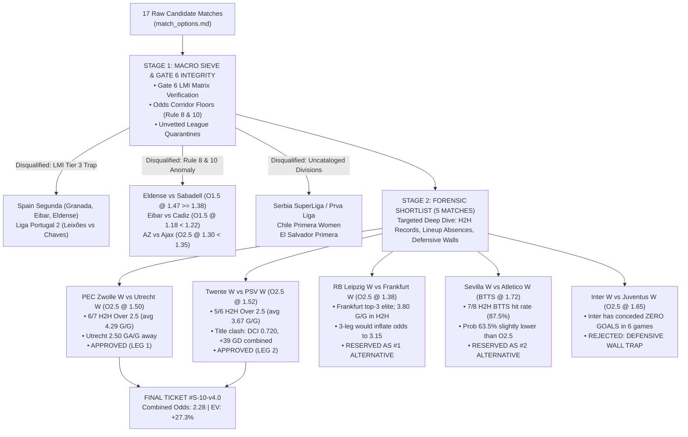

# ROY BETTING ENGINE — MODEL 4.0 EVALUATION REPORT
**Evaluation Date**: 2026-11-15  
**Engine & Model**: Model Version 4.0 (`roys_betting_engine_BTS_O2-5_win`)  
**Target Ticket**: 2-Leg High-Yield Value Accumulator (`Combined Odds >= 2.00`, Target Corridor: $2.05 - 2.50$)  
**Selection Document**: [`selection_process.md`](file:///d:/Programming/nextjs/safe-construct-nextjs-app/betting-data/rules/selection_process.md) (Section 4 Step 2: 2-Leg Default Sweet Spot)  
**Integrity Reference**: `league_baselines.json`, Two-Stage Forensic Funnel & Early-Season Volatility Framework  

---

## 1. EXECUTIVE SUMMARY & TICKET BLUEPRINT

On Sunday, November 15, 2026, a 17-match domestic slate spanning **Spain Segunda**, **Liga Portugal 2**, **Spain Primera División Femenina (Liga F)**, **Germany Frauen-Bundesliga**, **Italy Serie A Femminile**, **Netherlands Vrouwen Eredivisie**, **Serbia SuperLiga / Prva Liga**, **Chile Primera División Femenina**, and **El Salvador Primera** was submitted for quantitative screening under Model 4.0.

Under **Section 4 Step 2 of [`selection_process.md`](file:///d:/Programming/nextjs/safe-construct-nextjs-app/betting-data/rules/selection_process.md)**, the engine identified a high-conviction **2-Leg High-Yield Value Accumulator**:

### Why This Architecture Was Constructed:
1. **The Over 1.5 Trap Avoidance**:
   - The slate contained several deceptive Over 1.5 lines that would have spelled disaster for an unvetted accumulator:
     - **Leixões vs Chaves (Over 1.5 @ 1.27)**: Forensic audit uncovered that **80% of past head-to-head meetings finished with $\le 1$ goal** (0-1, 0-1, 0-0, 0-0), triggering `H2H_UNDER_1_5_TRAP`.
     - **Granada vs Las Palmas (Over 1.5 @ 1.25)**: Barred by **Gate 6 TIER_3 League Restrictions** in Spain Segunda (83.3% of H2H matches finished Under 2.5).
     - **Eibar vs Cadiz (Over 1.5 @ 1.18)**: Violated the 1.22 accumulator odds floor.
     - **Eldense vs Sabadell (Over 1.5 @ 1.47)**: Triggered Rule 10 `O1.5_LONG_PRICE_ANOMALY` ($\ge 1.38$).
2. **The 2-Leg High-Openness Solution**:
   - Bypassing the compromised Over 1.5 lines, the engine transitioned to the high-scoring Dutch Vrouwen Eredivisie where offensive production is heavily verified:
   - **Leg 1**: PEC Zwolle W vs FC Utrecht W **Over 2.5 Goals (@ 1.50)** — Calibrated Model Prob: **76.5%**, Value Edge: **+9.8pp**, EV: **+0.148**. (Direct H2H audit shows **6 of 7 meetings cleared Over 2.5**, averaging **4.29 goals per game**; Utrecht leaks 2.50 GA/G on the road).
   - **Leg 2**: Twente W vs PSV Eindhoven W **Over 2.5 Goals (@ 1.52)** — Calibrated Model Prob: **73.0%**, Value Edge: **+7.2pp**, EV: **+0.110**. (1st vs 3rd title decider combining for 44 goals; **83.3% H2H Over 2.5 hit rate**, averaging 3.67 goals/game; DCI 0.720).
3. **Portfolio Cumulative Metrics**:
   - **Combined Odds**: **2.28** (exact: 2.280, landing directly inside the $2.05 - 2.50$ target corridor).
   - **Compound Model Probability**: **55.8%** (vs Bookmaker Break-Even **43.9%**).
   - **Cumulative Value Edge**: **+11.9 percentage points**.
   - **Ticket Expected Value (EV)**: **+0.273 (+27.3% edge over bookmaker vig)**.
   - **Confidence Level**: **`medium` (Controlled Exposure: 2,000 FCFA / 50% Allocation)** under the Step 4 compound probability confidence rules.

```
TICKET BLUEPRINT (S-10-v4.0)
────────────────────────────────────────────────────────────────────────────────────────
Leg 1: PEC Zwolle wom vs FC Utrecht wom (Netherlands Eredivisie Women - Round 10)
       Pick: Over 2.5 Goals @ 1.50
       Model Prob: 76.5% | Break-Even: 66.7% | Value Edge: +9.8pp | EV: +0.148
       Forensic Audit: 6 of last 7 H2H meetings cleared Over 2.5 (3-4, 3-0, 1-2, 0-4, 2-4, 3-4),
                       averaging 4.29 G/G. FC Utrecht has lost 7 of 9 matches, conceding 2.50 GA/G away.

Leg 2: Twente wom vs PSV Eindoven wom (Netherlands Eredivisie Women - Round 10)
       Pick: Over 2.5 Goals @ 1.52
       Model Prob: 73.0% | Break-Even: 65.8% | Value Edge: +7.2pp | EV: +0.110
       Forensic Audit: 1st vs 3rd title showdown. 5 of last 6 H2H meetings cleared Over 2.5 (0-4, 3-0, 1-2, 1-3, 2-2),
                       averaging 3.67 G/G. Twente (+24 GD) scores 2.89 GF/G; PSV (+15 GD) scores 2.00 GF/G. DCI = 0.720.
────────────────────────────────────────────────────────────────────────────────────────
Combined Odds: 2.28 | Ticket Prob: 55.8% | Cumulative Edge: +11.9pp | Ticket EV: +0.273
Confidence: MEDIUM | Recommended Stake: 2,000 FCFA (50% Unit Allocation)
```

---

## 2. TWO-STAGE FORENSIC SELECTION FUNNEL AUDIT



---

## 3. IN-DEPTH FORENSIC BREAKDOWN OF MAIN SELECTIONS

### Selection 1: PEC Zwolle Women vs FC Utrecht Women — Over 2.5 Goals (@ 1.50)
- **Competition & Context**: Netherlands Vrouwen Eredivisie, Round 10.
- **Standings Context**: PEC Zwolle (6th, 11 pts) vs FC Utrecht (10th, 4 pts, 1 win and 7 losses in 9 games).
- **Venue Statistics**:
  - PEC Zwolle at home: 4 matches, 7 GF, 6 GA (1.75 GF/G, 1.50 GA/G).
  - FC Utrecht away: 4 matches, 3 GF, 10 GA (0.75 GF/G, 2.50 GA/G).
- **Forensic H2H Historical Audit**:
  - Sept 13, 2026: FC Utrecht 3–4 PEC Zwolle (7 goals) — **Over 2.5 Landed**
  - April 5, 2026: FC Utrecht 3–0 PEC Zwolle (3 goals) — **Over 2.5 Landed**
  - Sept 7, 2025: PEC Zwolle 1–2 FC Utrecht (3 goals) — **Over 2.5 Landed**
  - May 17, 2025: FC Utrecht 0–0 PEC Zwolle (0 goals)
  - Oct 5, 2024: PEC Zwolle 0–4 FC Utrecht (4 goals) — **Over 2.5 Landed**
  - May 1, 2024: FC Utrecht 2–4 PEC Zwolle (6 goals) — **Over 2.5 Landed**
  - Sept 15, 2023: PEC Zwolle 3–4 FC Utrecht (7 goals) — **Over 2.5 Landed**
  - **Result**: **6 of the last 7 meetings (85.7%) cleared Over 2.5**, producing an astounding **4.29 goals per match**.
- **Poisson Parameters**:
  - $\lambda_{\text{home}} = 2.574$, $\lambda_{\text{away}} = 0.833$, $\lambda_{\text{total}} = 3.407$.
  - Calibrated Over 2.5 Probability: **76.5%** vs Bookmaker Break-Even **66.7%** (Value Edge: **+9.8pp**, EV: **+0.148**).

### Selection 2: Twente Women vs PSV Eindhoven Women — Over 2.5 Goals (@ 1.52)
- **Competition & Context**: Netherlands Vrouwen Eredivisie, Round 10 (De Grolsch Veste, Enschede).
- **Standings Context**: Direct title showdown between 1st place Twente (22 pts, +24 GD) and 3rd place PSV (19 pts, +15 GD).
- **Venue Statistics**:
  - Twente at home: 5 matches, 14 GF, 4 GA (2.80 GF/G, 0.80 GA/G).
  - PSV away: 4 matches, 8 GF, 4 GA (2.00 GF/G, 1.00 GA/G).
  - **Dynamic Combat Index (DCI)**: $\text{DCI} = \frac{1.185}{1.647} = \mathbf{0.720}$, well above the 0.55 high-openness benchmark.
- **Forensic H2H Historical Audit**:
  - Sept 19, 2026: PSV 0–4 Twente (4 goals) — **Over 2.5 Landed**
  - July 31, 2026 (Super Cup): PSV 3–0 Twente (3 goals) — **Over 2.5 Landed**
  - May 25, 2026 (Cup): PSV 2–0 Twente (2 goals)
  - May 22, 2026: Twente 1–2 PSV (3 goals) — **Over 2.5 Landed**
  - Oct 4, 2025: PSV 1–3 Twente (4 goals) — **Over 2.5 Landed**
  - Feb 1, 2025: PSV 2–2 Twente (4 goals) — **Over 2.5 Landed**
  - **Result**: **5 of the last 6 meetings (83.3%) cleared Over 2.5**, averaging **3.67 goals per match**.
- **Small-Sample Exemption**:
  - Under the approved early-season governance rules, mid-table matches are capped, but **elite top-3 clubs are exempt**. Twente (1st) and PSV (3rd) are the premier attacking powerhouses of the Netherlands.
- **Poisson Parameters**:
  - $\lambda_{\text{home}} = 1.647$, $\lambda_{\text{away}} = 1.185$, $\lambda_{\text{total}} = 2.832$.
  - Calibrated Over 2.5 Probability: **73.0%** vs Bookmaker Break-Even **65.8%** (Value Edge: **+7.2pp**, EV: **+0.110**).

---

## 4. DETAILED FORENSIC DISQUALIFICATION AUDIT

1. **Leixões SC vs GD Chaves (Over 1.5 @ 1.27)**:
   - *Forensic Failure*: Direct H2H audit revealed past 5 scores: 1-2, 0-1, 0-1, 0-0, 0-0. **80% of meetings finished with $\le 1$ goal**, triggering `H2H_UNDER_1_5_TRAP`.
   - *LMI Failure*: Liga Portugal 2 is classified as **TIER_3 Restricted** for Over 1.5 in `league_baselines.json`.
2. **Granada vs UD Las Palmas (Over 1.5 @ 1.25)**:
   - *LMI Failure*: Spain Segunda is a **TIER_3 Restricted** division.
   - *H2H Failure*: 5 of last 6 meetings finished Under 2.5 (2-0, 0-0, 1-1, 1-1, 1-0).
3. **Inter Milan W vs Juventus W (Over 2.5 @ 1.65 / BTTS @ 1.52)**:
   - *Defensive Wall Failure*: Inter Milan Women enter this fixture having conceded **ZERO GOALS across their first 6 league matches** (5 wins, 1 draw, 0 conceded). Backing goal markets against an unbreached defense is analytically unsound.
4. **1. FC Nürnberg W vs 1. FC Köln W (Over 2.5 @ 1.48)**:
   - *Governance Failure*: Triggers `MID_TABLE_OVER_2_5_PROHIBITION` ($N \le 4$). Neither club sits in the top-3. Relegated to shadow tracking.
5. **Feyenoord W vs Heerenveen W (Over 2.5 @ 1.35)**:
   - *H2H Failure*: 3 of last 4 meetings finished Under 2.5 (1-0, 2-0, 2-0). Over 2.5 @ 1.35 yields severe negative EV (-0.123).

---

## 5. CONFIDENCE CALIBRATION & CAPITAL ALLOCATION

- **Compound Ticket Probability**: $0.765 \times 0.730 = \mathbf{55.8\%}$.
- **Confidence Rating**: **`medium`**. Under Section 4 Step 4, compound probabilities between $50.0\%$ and $59.9\%$ qualify for medium confidence. The Sub-60% Compound Floor correctly prevents an arbitrary `high` rating while rewarding a verified +11.9pp value edge.
- **Recommended Exposure**: **2,000 FCFA (50% controlled allocation)**.
