# AUTOMATED SELECTION PROCESS & PORTFOLIO RULES FOR TOURNAMENTS & NATIONAL TEAMS (`selection_process_tournament.md`)

> **Model Compatibility**: Exclusively designed for **Model 5.0 (`roys_tournament_international_engine`)**.  
> **Primary Purpose**: Standardize the workflow from raw tournament shortlists into a finalized, high-safety **2-leg (maximum 3-leg)** betting ticket with combined odds $\ge 2.00$, while logging all remaining promising fixtures in a shadow tracking portfolio (`alternatives`) for empirical model calibration.

---

## 1. CORE PHILOSOPHY & OBJECTIVES

1. **Eliminate Tournament Draw Attrition**:
   - International tournaments (AFCON, Euro, World Cup) and continental knockout ties produce regular-time draw frequencies approaching $28\% - 33\%$.
   - Wagering on straight 1X2 match winners in competitive tournament matches is the leading cause of accumulator breakdown. Model 5.0 prioritizes **Draw No Bet (DNB)**, **Double Chance (1X / X2)**, and **Over 1.5 Goals** to nullify regular-time draw risk.
2. **Strict Combined Odds Floor ($\ge 2.00$)**:
   - The primary ticket target is **$2.00 - 2.50$** combined odds.
   - We target **2-leg accumulators** as the default standard. A **3-leg hybrid accumulator** is permitted only when it combines three ultra-safe legs ($\ge 80\%$ individual probability) to reach the 2.00 floor without forcing high-variance individual picks. Never 4 or more legs.
3. **The Two-Tier Portfolio Architecture**:
   - **Tier 1: Active Capital Portfolio (`selections`)**:
     - Exactly **1 to 3 matches** (default: 2 legs, combined odds $\ge 2.00$).
     - Real capital is placed exclusively on this ticket, protecting the bankroll from accumulator drag.
   - **Tier 2: Shadow Tracking Portfolio (`alternatives`)**:
     - The top **3 to 5 next-best candidate fixtures** that met all Elo, CSI, and EV thresholds but were not included in the primary ticket.
     - Evaluated with identical mathematical rigor and saved permanently in the database to benchmark Model 5.0's predictive accuracy over time.
   - **Mandatory Shadow Candidate Attributes**:
     - Every candidate logged in `alternatives` must include both:
       1. **`comment`**: Exactly one clear sentence defining the explicit rejection reason (e.g. juiced odds $< 1.22$, elevated draw risk, or away favorite hazard).
       2. **`warnings`**: Structured warning objects detailing the risks identified with `type`, `severity`, `direction`, `description`, and `evidence`.

---

## 2. CANDIDATE TRIAGE & DATA ELIGIBILITY

Before admitting a tournament fixture into the evaluation pipeline:

### 2.1 Track A: Continental Club Competitions (UCL, UEL, CAF CL)
- Confirm both clubs' domestic leagues and assign their **Competition Strength Index (CSI)** multiplier:
  - Tier 1: $1.00$ (EPL, La Liga, Serie A, Bundesliga, Egypt, Morocco, Algeria)
  - Tier 2: $0.85$ (Ligue 1, Portugal, Netherlands, DR Congo, Tanzania, South Africa)
  - Tier 3: $0.72$ (Belgium, Turkey, Scotland, Czechia)
  - Tier 4: $0.60$ (Switzerland, Austria, Greece, Denmark)
  - Tier 5: $0.50$ (Croatia, Serbia, Bulgaria, Romania, Rest of Africa)
- Normalize domestic scoring and concession rates using:
  $\text{GF}^* = \text{GF}_{\text{domestic}} \times \text{CSI}$ and $\text{GA}^* = \text{GA}_{\text{domestic}} \times (2.0 - \text{CSI})$.
- Verify whether the tie is a 1st leg or 2nd leg. If Leg 2, check the aggregate score to evaluate tactical desperation.

### 2.2 Track B: National Team Competitions (AFCON, Euro, World Cup, Nations League)
- Look up official **World Football Elo Ratings** for both nations:
  - Calculate net gap: $\Delta \text{Elo} = \text{Elo}_A - \text{Elo}_B + H_{\text{venue}}$.
  - Apply venue rule: $H_{\text{venue}} = 0$ for neutral venues; $H_{\text{venue}} = +100$ only for true host playing in their home stadiums.
- Check competition stage:
  - Group Stage: $K_s = 1.00$. Check for Matchday 3 dead-rubber scenarios (already qualified teams).
  - Single-Leg Knockout Stage: $K_s = 0.88$ (**Knockout Compression Factor**).

---

## 3. SAFE ACCUMULATOR ARCHETYPES FOR TOURNAMENTS

Model 5.0 constructs tickets using four battle-tested portfolio archetypes:

```mermaid
graph TD
    subgraph Arch1["Archetype 1: Mismatch Dominance Pair"]
        A1_Leg1["Leg 1: Dominant Winner (1X2)<br/>(ΔElo ≥ 250 or DR ≥ 3.0 | Odds 1.45 - 1.70)"]
        A1_Leg2["Leg 2: Over 1.5 Anchor<br/>(Prob ≥ 82% | Odds 1.24 - 1.35)"]
        A1_Leg1 --- A1_Leg2 --> A1_Total["Combined Odds: 2.00 - 2.30"]
    end

    subgraph Arch2["Archetype 2: Draw-Shielded Value Pair"]
        A2_Leg1["Leg 1: Draw No Bet (DNB)<br/>(Win Prob ≥ 58% | Odds 1.38 - 1.60)"]
        A2_Leg2["Leg 2: Double Chance (1X/X2) or O1.5<br/>(Prob ≥ 80% | Odds 1.25 - 1.35)"]
        A2_Leg1 --- A2_Leg2 --> A2_Total["Combined Odds: 2.00 - 2.25"]
    end

    subgraph Arch3["Archetype 3: Knockout Fortress Pair"]
        A3_Leg1["Leg 1: Under 3.5 Goals Shield<br/>(Single-leg knockout | Odds 1.30 - 1.45)"]
        A3_Leg2["Leg 2: Double Chance (1X/X2)<br/>(Prob ≥ 80% | Odds 1.30 - 1.45)"]
        A3_Leg1 --- A3_Leg2 --> A3_Total["Combined Odds: 2.00 - 2.25"]
    end

    subgraph Arch4["Archetype 4: 3-Leg Hybrid Safety Trio"]
        A4_Leg1["Leg 1: Over 1.5 Anchor (@ 1.25 - 1.30)"]
        A4_Leg2["Leg 2: Double Chance 1X (@ 1.25 - 1.30)"]
        A4_Leg3["Leg 3: Draw No Bet (@ 1.30 - 1.40)"]
        A4_Leg1 --- A4_Leg2 --- A4_Leg3 --> A4_Total["Combined Odds: 2.05 - 2.40"]
    end
```



### 3.1 Archetype 1: The Mismatch Dominance Pair (Dominant 1X2 + O1.5 Anchor)
- **Structure**:
  - **Leg 1**: Dominant Favorite to Win (1X2 @ $1.45 - 1.70$). Requirements: $\Delta \text{Elo} \ge 250$ points or CSI-adjusted Dominance Ratio $\ge 3.0$, Win Probability $\ge 72\%$.
  - **Leg 2**: Over 1.5 Goals Anchor (@ $1.24 - 1.35$). Requirements: Model Probability $\ge 82\%$.
- **Combined Odds**: $2.00 - 2.30$.
- **Expected Hit Rate**: $\approx 60\% - 68\%$.
- **Ideal For**: Group stage matchdays featuring an elite favorite vs a peripheral team, paired with an open offensive clash.

### 3.2 Archetype 2: The Draw-Shielded Value Pair (DNB + Resilience Anchor)
- **Structure**:
  - **Leg 1**: Draw No Bet (DNB @ $1.38 - 1.60$). Requirements: Win Prob $\ge 58\%$, Draw Prob $\ge 24\%$, Positive EV.
  - **Leg 2**: Double Chance (1X/X2 @ $1.25 - 1.35$) OR Over 1.5 Goals (@ $1.25 - 1.35$).
- **Combined Odds**: $2.00 - 2.25$.
- **Safety Mechanism**: If Leg 1 finishes in a draw, the DNB selection voids at 1.00 odds, preventing ticket loss and returning stake or winning on Leg 2.
- **Ideal For**: Competitive tournament fixtures where one side has a moderate edge but cannot be trusted to prevent a 90-minute stalemate.
- **Mandatory Constraint**: Must strictly comply with **Rule 9 (Elite Away DNB Restriction)**. Backing DNB on an away team is prohibited if the host is a Top-25 Elo nation or has $P(\text{Home Win}) \ge 25\%$; in such derbies, use Double Chance (X2) or omit the fixture.

### 3.3 Archetype 3: The Knockout Fortress Pair (Under 3.5 + Double Chance)
- **Structure**:
  - **Leg 1**: Under 3.5 Goals (@ $1.30 - 1.45$). Requirements: Single-leg knockout stage, combined $\lambda_{\text{total}} \le 2.25$, Under 3.5 Prob $\ge 78\%$.
  - **Leg 2**: Double Chance (1X or X2 @ $1.30 - 1.45$). Requirements: Combined Prob $\ge 80\%$.
- **Combined Odds**: $2.00 - 2.25$.
- **Ideal For**: High-stakes quarter-finals, semi-finals, and finals (AFCON, Euro, World Cup) where tactical conservatism dominates regular time.

### 3.4 Archetype 4: The 3-Leg Hybrid Safety Trio (Anchor + Double Chance + DNB)
- **Structure**:
  - Three ultra-safe picks with individual probabilities $\ge 80\%$ (or high-probability DNB):
    - Pick 1: Over 1.5 Goals Anchor (@ $1.25 - 1.30$, Prob $\ge 82\%$)
    - Pick 2: Double Chance 1X or X2 (@ $1.24 - 1.32$, Prob $\ge 82\%$)
    - Pick 3: Draw No Bet Favorite (@ $1.32 - 1.42$, Prob $\ge 75\%$ void-adjusted)
- **Combined Odds**: $2.05 - 2.45$.
- **Role**: Fallback architecture when no single high-odds leg meets strict safety gating, allowing the ticket to reach 2.00 odds without gambling on low-probability selections.

---

## 4. HARD DISQUALIFICATION & STOP RULES FOR TOURNAMENTS

To prevent catastrophic failures, the engine strictly halts or disqualifies selections under these nine conditions:

1. **The Knockout Match Winner Hard-Stop**:
   - In a single-leg knockout fixture between two balanced nations ($|\Delta \text{Elo}| < 150$), **straight 1X2 Match Winner bets are strictly DISQUALIFIED**. 
   - *Reason*: Draw probabilities exceed $30\%$ as teams settle for extra time. Must pivot to **Draw No Bet (DNB)**, **Double Chance**, or **Under 3.5 Goals**.
2. **The High-Mismatch BTTS Disqualification**:
   - In international qualifiers or group stages where $\Delta \text{Elo} \ge 200$ (e.g. England vs San Marino, Senegal vs South Sudan), **BTTS Yes is strictly DISQUALIFIED**.
   - *Reason*: Underdogs frequently register zero shots on target; favorites win 3-0, 4-0, or 5-0 to nil.
3. **The Dead-Rubber Group Matchday 3 Halt**:
   - If a national team or continental club has already mathematically secured 1st place in their group before Matchday 3, straight 1X2 bets on that favorite are **HALTED**.
   - *Reason*: High likelihood of resting 5–8 starting players (`GROUP_STAGE_DEAD_RUBBER`).
4. **The Second-Leg Aggregate Trap**:
   - In continental club 2-legged knockouts, if Team A holds a $\ge 2$ goal lead from Leg 1, Under goal markets on Leg 2 are **HALTED** unless the trailing team lacks any attacking capacity.
   - *Reason*: The trailing team is forced to abandon low blocks and attack recklessly, opening wide transition spaces.
5. **The Host Disadvantage Illusion**:
   - Never apply standard domestic home advantage ($+100$ Elo) to neutral tournament matches played in another country. Doing so artificially overrates nominal "home" teams.
6. **The Heavy-Mismatch Unquoted Anchor & Over 2.5 Trap Rule**:
   - If a heavy favorite is priced $\le 1.12$ and bookmakers omit the Over 1.5 line (`-`), **NEVER force a trade-up to Over 2.5** unless the underdog averages $\ge 0.90$ GF/G in away qualifiers or match $\text{DCI} \ge 0.35$.
   - *Reason*: Underdogs like Somalia or Sudan virtually never score. Once the powerhouse takes a 2-0 lead, they slow game tempo, rotate starters, and finish 2-0, causing Over 2.5 to fail. Such matches must be marked `UNQUOTED_ANCHOR_DISQUALIFIED` and discarded.
7. **The Market-Elo Odds Inversion Hard-Stop**:
   - If bookmaker pricing directly contradicts a net Elo superiority of $\ge +120$ points (i.e. the higher-ranked home nation is priced as a heavy underdog, e.g. `Armenia Elo 1,420 @ 2.97 vs Cyprus Elo 1,320 @ 2.56`), the fixture is **strictly disqualified from active capital**.
   - *Reason*: Bookmakers have priced in critical unmodeled team news (star withdrawals, coaching boycotts, or sudden squad rotation) that historical ratings lag behind (`EXTERNAL_ODDS_INVERSION_WARNING`).
8. **The Juiced Odds Corridor Relegation Rule ($< 1.22$)**:
   - In tournaments, when Over 1.5 odds drop below $1.22$ (e.g. $1.13 - 1.18$), they are **disqualified from 2-leg main tickets** and relegated to shadow tracking (`alternatives`) unless paired in an approved 3-leg hybrid ticket where remaining legs provide sufficient odds buffer.
9. **The Elite Away Draw No Bet (DNB) Restriction Rule (`ELITE_AWAY_DNB_HAZARD`)**:
   - In international and continental tournament fixtures, backing an away favorite on **Draw No Bet (DNB / Asian Handicap 0)** is **strictly DISQUALIFIED from real-money tickets** whenever either condition is met:
     1. The home team ranks in the **Global World Football Elo Top 25** (e.g. Italy, Germany, Netherlands, Croatia, Uruguay), OR
     2. The model projects a home win probability $P(\text{Home Win}) \ge 25.0\%$.
   - *Reason*: DNB only protects against a 90-minute draw (voiding the selection at 1.00 odds). It provides **zero capital protection against an outright home defeat**. In elite fixtures played at hostile traditional venues (e.g. Italy at San Siro, England at Wembley, Brazil at Maracanã), home crowd momentum and world-class individual attacking quality frequently overcome modest negative Elo differentials.
   - *Actionable Requirement*: In any elite away clash meeting these criteria, backing DNB is strictly forbidden. The selection must either be converted to **Double Chance (X2)** (which wins on both draw and away win) or relegated to the shadow candidate portfolio (`alternatives`).

---

## 5. SELECTION TO EXECUTION WORKFLOW

```
  ┌────────────────────────────────────────────────────────┐
  │   1. Input Raw Tournament Fixtures (UCL, AFCON, etc.)  │
  └───────────────────────────┬────────────────────────────┘
                              │
  ┌───────────────────────────▼────────────────────────────┐
  │   2. Sourcing: World Elo Ratings & CSI League Tiers    │
  └───────────────────────────┬────────────────────────────┘
                              │
  ┌───────────────────────────▼────────────────────────────┐
  │   3. Compute Expected Goals (λ_A, λ_B) & Bivariate     │
  │      Poisson Probabilities (O1.5, DNB, DC, U3.5, 1X2)  │
  └───────────────────────────┬────────────────────────────┘
                              │
  ┌───────────────────────────▼────────────────────────────┐
  │   4. Apply Hard-Stops & Disqualification Rules         │
  └───────────────────────────┬────────────────────────────┘
                              │
  ┌───────────────────────────▼────────────────────────────┐
  │   5. Construct Ticket (Archetypes 1 - 4 | Odds ≥ 2.00) │
  │      -> Main Selections: Exactly 2 Legs (or 3 Legs)    │
  │      -> Shadow Alternatives: Top 3 - 5 Candidate Picks │
  └───────────────────────────┬────────────────────────────┘
                              │
  ┌───────────────────────────▼────────────────────────────┐
  │   6. Export Standard JSON (Ticket #S-X-v5.0)           │
  └────────────────────────────────────────────────────────┘
```

