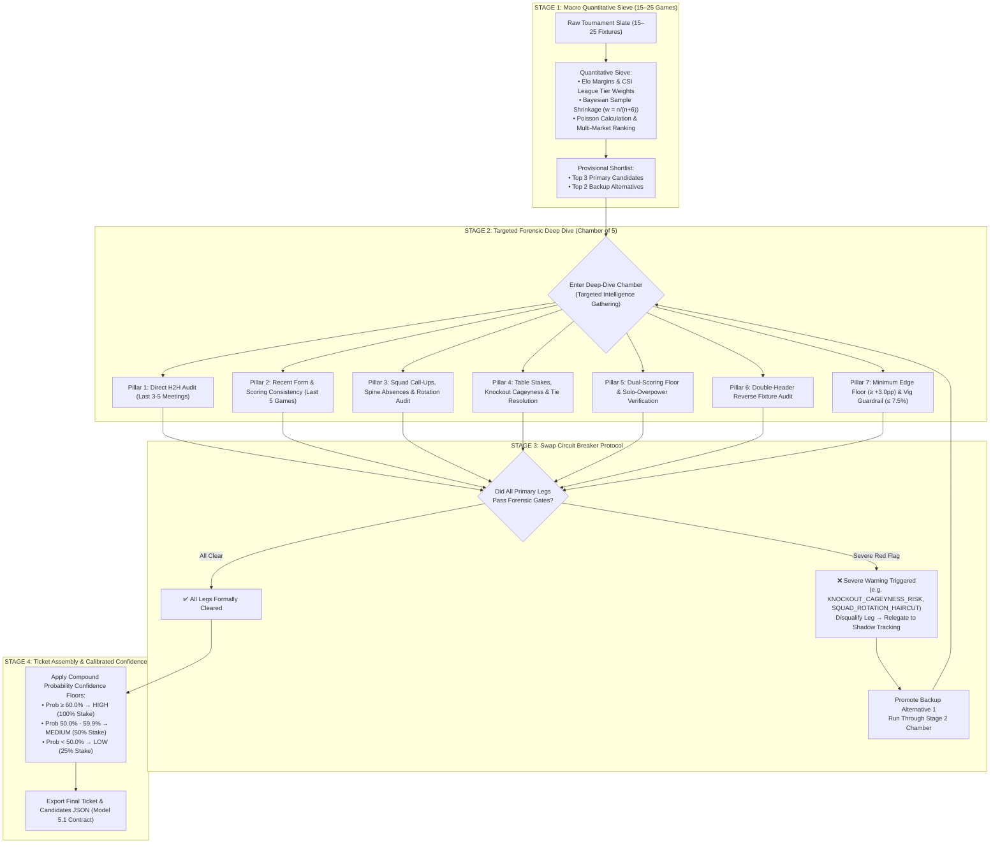

# AUTOMATED SELECTION PROCESS & PORTFOLIO RULES FOR TOURNAMENTS & NATIONAL TEAMS (`selection_process_tournament.md`)

> **Model Compatibility**: Exclusively designed for **Model 5.1 (`roys_tournament_international_engine`)**.  
> **Primary Purpose**: Standardize the workflow from raw tournament shortlists into a finalized, high-safety **2-leg or 3-leg** betting ticket with combined odds target $\ge 2.00$ (with flexible floor $1.75 - 2.00$ / no-bet discipline), while logging all remaining promising fixtures in a shadow tracking portfolio (`alternatives`) for empirical model calibration.

---

## 1. CORE PHILOSOPHY & OBJECTIVES

1. **Eliminate Tournament Draw Attrition**:
   - International tournaments (AFCON, Euro, World Cup) and continental/domestic knockout ties produce regular-time draw frequencies approaching $28\% - 33\%$.
   - Wagering on straight 1X2 match winners in competitive tournament matches is the leading cause of accumulator breakdown. Model 5.1 prioritizes **Draw No Bet (DNB)**, **Double Chance (1X / X2)**, **To Qualify**, and **Over 1.5 Goals** to nullify regular-time draw and rotation risk.
2. **Strict Combined Odds Target ($\ge 2.00$) with Anti-Odds-Chasing Discipline**:
   - The primary ticket target is **$2.00 - 2.50$** combined odds.
   - We target **2-leg accumulators** as the default standard. A **3-leg hybrid accumulator (Archetype 1B or Archetype 4)** is permitted when it combines high-floor legs ($\ge 80\%$ individual probability) to reach target odds without forcing high-variance individual picks.
   - **Anti-Odds-Chasing Principle**: Never downgrade individual selection probability or positive market EV strictly to satisfy an arbitrary 2-leg odds floor. When only low-odds anchors pass safety filters, the engine must either construct a 3-leg triad (Archetype 1B) or deploy flexible floor discipline ($1.75 - 2.00$ or NO BET).
3. **The Two-Tier Portfolio Architecture**:
   - **Tier 1: Active Capital Portfolio (`selections`)**:
     - Exactly **1 to 3 matches** (default: 2 legs, combined odds $\ge 2.00$, flexible floor $1.75 - 2.00$).
     - Real capital is placed exclusively on this ticket, protecting the bankroll from accumulator drag.
   - **Tier 2: Shadow Tracking Portfolio (`alternatives`)**:
     - The top **3 to 5 next-best candidate fixtures** that met all Elo, CSI, and EV thresholds but were not included in the primary ticket.
     - Evaluated with identical mathematical rigor and saved permanently in the database to benchmark Model 5.1's predictive accuracy over time.
   - **Mandatory Shadow Candidate Attributes**:
     - Every candidate logged in `alternatives` must include both:
       1. **`comment`**: Exactly one clear sentence defining the explicit rejection reason (e.g. juiced odds $< 1.22$, elevated draw risk, or away favorite hazard).
       2. **`warnings`**: Structured warning objects detailing the risks identified with `type`, `severity`, `direction`, `description`, and `evidence`.

---

## 2. CANDIDATE TRIAGE & DATA ELIGIBILITY

Before admitting a tournament fixture into the evaluation pipeline:

### 2.1 Track A: Continental Club Competitions & Domestic Cup Knockouts
- Confirm both clubs' domestic leagues and assign their **Competition Strength Index (CSI)** multiplier:
  - Tier 1: $1.00$ (EPL, La Liga, Serie A, Bundesliga, Egypt, Morocco, Algeria)
  - Tier 2: $0.85$ (Ligue 1, Portugal, Netherlands, DR Congo, Tanzania, South Africa)
  - Tier 3: $0.72$ (Belgium, Turkey, Scotland, Czechia)
  - Tier 4: $0.60$ (Switzerland, Austria, Greece, Denmark, Segunda Federación)
  - Tier 5: $0.50$ (Croatia, Serbia, Bulgaria, Romania, Tercera Federación, Rest of Africa)
- Normalize domestic scoring and concession rates using tier-specific baselines:
  $\text{GF}^* = \text{GF}_{\text{domestic}} \times \text{CSI}$ and $\text{GA}^* = \text{GA}_{\text{domestic}} \times (2.0 - \text{CSI})$.
- Apply **Bayesian Sample Shrinkage** for small sample sizes ($n < 12$ matches):
  $$\text{GF}_{\text{shrunk}} = w \cdot \text{GF}_{\text{sample}} + (1 - w) \cdot G_{\text{baseline}}$$
  where $w = \frac{n}{n + 6}$.
- **Knockout Tie Format Metadata**:
  Record `tie_format` (`"single_leg_knockout"`, `"two_leg_first"`, `"two_leg_second"`, or `"group_stage"`). If 2nd leg, record `first_leg_margin_for_target`.
- **Knockout Market Routing & Vig Guardrail**:
  - In single-leg or 2nd-leg knockout ties, evaluate **`To Qualify`** alongside 1X2, Over 1.5, and DNB.
  - **Bookmaker Vig Guardrail**: For any candidate `To Qualify` market, bookmaker overround must satisfy $\text{Vig} \le 7.5\%$. If vig $> 7.5\%$, reject `To Qualify` and evaluate Double Chance or Over 1.5.

### 2.2 Track B: National Team Competitions (AFCON, Euro, World Cup, Nations League)
- Look up official **World Football Elo Ratings** for both nations:
  - Calculate net gap: $\Delta \text{Elo} = \text{Elo}_A - \text{Elo}_B + H_{\text{venue}}$.
  - Apply venue rule: $H_{\text{venue}} = 0$ for neutral venues; $H_{\text{venue}} = +100$ only for true host playing in their home stadiums.
- Check competition stage:
  - Group Stage: $K_s = 1.00$. Check for Matchday 3 dead-rubber scenarios (already qualified teams).
  - Single-Leg Knockout Stage: $K_s = 0.88$ (**Knockout Compression Factor**).

---

## 3. SAFE ACCUMULATOR ARCHETYPES FOR TOURNAMENTS

Model 5.1 constructs tickets using five battle-tested portfolio archetypes:

```mermaid
graph TD
    subgraph Arch1["Archetype 1: Mismatch Dominance Pair"]
        A1_Leg1["Leg 1: Dominant Winner / To Qualify<br/>(ΔElo ≥ 250 or DR ≥ 3.0 | Odds 1.35 - 1.70)"]
        A1_Leg2["Leg 2: Over 1.5 Anchor<br/>(Prob ≥ 82%, Edge ≥ +3.0pp | Odds 1.24 - 1.35)"]
        A1_Leg1 --- A1_Leg2 --> A1_Total["Combined Odds: 2.00 - 2.30"]
    end

    subgraph Arch1B["Archetype 1B: Knockout Safety Triad"]
        A1B_Leg1["Leg 1: Over 1.5 Anchor (Prob ≥ 82% | Odds 1.24 - 1.30)"]
        A1B_Leg2["Leg 2: To Qualify Anchor (Prob ≥ 80% | Odds 1.22 - 1.30)"]
        A1B_Leg3["Leg 3: Double Chance / DNB (Prob ≥ 80% | Odds 1.24 - 1.32)"]
        A1B_Leg1 --- A1B_Leg2 --- A1B_Leg3 --> A1B_Total["Combined Odds: 1.95 - 2.25"]
    end

    subgraph Arch2["Archetype 2: Draw-Shielded Value Pair"]
        A2_Leg1["Leg 1: Draw No Bet (DNB)<br/>(Win Prob ≥ 58% | Odds 1.38 - 1.60)"]
        A2_Leg2["Leg 2: Double Chance (1X/X2) or O1.5<br/>(Prob ≥ 80% | Odds 1.25 - 1.35)"]
        A2_Leg1 --- A2_Leg2 --> A2_Total["Combined Odds: 2.00 - 2.25"]
    end

    subgraph Arch3["Archetype 3: Knockout Fortress Pair"]
        A3_Leg1["Leg 1: Under 3.5 Goals Shield<br/>(Single-leg knockout | Odds 1.30 - 1.45)"]
        A3_Leg2["Leg 2: Double Chance (1X/X2)<br/>(Prob ≥ 80% | Odds 1.30 - 1.45)"]
        A3_Leg1 --- A3_Leg2 --> A3_Total["Combined Odds: 2.00 - 2.25"]
    end

    subgraph Arch4["Archetype 4: 3-Leg Hybrid Safety Trio"]
        A4_Leg1["Leg 1: Over 1.5 Anchor (@ 1.25 - 1.30)"]
        A4_Leg2["Leg 2: Double Chance 1X (@ 1.25 - 1.30)"]
        A4_Leg3["Leg 3: Draw No Bet (@ 1.30 - 1.40)"]
        A4_Leg1 --- A4_Leg2 --- A4_Leg3 --> A4_Total["Combined Odds: 2.05 - 2.40"]
    end
```



### 3.1 Archetype 1: The Mismatch Dominance Pair (Dominant 1X2 / To Qualify + O1.5 Anchor)
- **Structure**:
  - **Leg 1**: Dominant Favorite to Win (1X2 @ $1.45 - 1.70$) OR Dominant Favorite To Qualify (@ $1.35 - 1.55$). Requirements: $\Delta \text{Elo} \ge 250$ points or CSI-adjusted Dominance Ratio $\ge 3.0$, Win Probability $\ge 72\%$. Must NOT be subject to `SQUAD_ROTATION_HAIRCUT`.
  - **Leg 2**: Over 1.5 Goals Anchor (@ $1.24 - 1.35$). Requirements: Model Probability $\ge 82\%$, Value Edge $\ge +3.0\text{pp}$.
- **Combined Odds**: $2.00 - 2.30$.
- **Expected Hit Rate**: $\approx 60\% - 68\%$.
- **Ideal For**: Group stage matchdays or cup knockout rounds featuring an unrotated elite favorite vs a peripheral team, paired with an open offensive clash.

### 3.2 Archetype 1B: The Knockout Safety Triad (3-Leg High-Floor Anchor Trio)
- **Structure**:
  - Three ultra-high-probability selections with individual probabilities strictly $\ge 80\%$:
    - **Leg 1**: Over 1.5 Goals Anchor (@ $1.24 - 1.30$, Prob $\ge 82\%$, Edge $\ge +3.0\text{pp}$).
    - **Leg 2**: To Qualify Anchor (@ $1.22 - 1.30$, Prob $\ge 80\%$, vig $\le 7.5\%$) or second Over 1.5 Anchor.
    - **Leg 3**: Double Chance 1X or X2 (@ $1.24 - 1.32$, Prob $\ge 80\%$).
- **Combined Odds**: $1.95 - 2.25$.
- **Compound Probability**: $\approx 53.0\% - 60.0\%$.
- **Role & Purpose**: Eliminates odds-chasing distortion. When a slate contains multiple high-conviction low-odds anchors ($1.25 - 1.30$), Archetype 1B allows the engine to assemble a robust ticket without gambling on a high-variance, rotated 1X2 match winner.

### 3.3 Archetype 2: The Draw-Shielded Value Pair (DNB + Resilience Anchor)
- **Structure**:
  - **Leg 1**: Draw No Bet (DNB @ $1.38 - 1.60$). Requirements: Win Prob $\ge 58\%$, Draw Prob $\ge 24\%$, Positive EV.
  - **Leg 2**: Double Chance (1X/X2 @ $1.25 - 1.35$) OR Over 1.5 Goals (@ $1.25 - 1.35$, Edge $\ge +3.0\text{pp}$).
- **Combined Odds**: $2.00 - 2.25$.
- **Safety Mechanism**: If Leg 1 finishes in a draw, the DNB selection voids at 1.00 odds, preventing ticket loss and returning stake or winning on Leg 2.
- **Ideal For**: Competitive tournament fixtures where one side has a moderate edge but cannot be trusted to prevent a 90-minute stalemate.
- **Mandatory Constraint**: Must strictly comply with **Rule 9 (Elite Away DNB Restriction)**. Backing DNB on an away team is prohibited if the host is a Top-25 Elo nation or has $P(\text{Home Win}) \ge 25\%$; in such derbies, use Double Chance (X2) or omit the fixture.

### 3.4 Archetype 3: The Knockout Fortress Pair (Under 3.5 + Double Chance)
- **Structure**:
  - **Leg 1**: Under 3.5 Goals (@ $1.30 - 1.45$). Requirements: Single-leg knockout stage, combined $\lambda_{\text{total}} \le 2.25$, Under 3.5 Prob $\ge 78\%$.
  - **Leg 2**: Double Chance (1X or X2 @ $1.30 - 1.45$). Requirements: Combined Prob $\ge 80\%$.
- **Combined Odds**: $2.00 - 2.25$.
- **Ideal For**: High-stakes quarter-finals, semi-finals, and finals (AFCON, Euro, World Cup) where tactical conservatism dominates regular time.

### 3.5 Archetype 4: The 3-Leg Hybrid Safety Trio (Anchor + Double Chance + DNB)
- **Structure**:
  - Three safe picks combining goal expectancy, double chance, and draw shield:
    - Pick 1: Over 1.5 Goals Anchor (@ $1.25 - 1.30$, Prob $\ge 82\%$, Edge $\ge +3.0\text{pp}$)
    - Pick 2: Double Chance 1X or X2 (@ $1.24 - 1.32$, Prob $\ge 82\%$)
    - Pick 3: Draw No Bet Favorite (@ $1.32 - 1.42$, Prob $\ge 75\%$ void-adjusted)
- **Combined Odds**: $2.05 - 2.45$.
- **Role**: Fallback architecture when no single high-odds leg meets strict safety gating, allowing the ticket to reach 2.00 odds without gambling on low-probability selections.

### 3.6 Flexible Combined Odds Floor ($1.75 - 2.00$) & No-Bet Discipline
- **The Anti-Downgrade Mandate**: The engine must **NEVER** downgrade selection safety or trade positive EV for lower hit-rate markets (e.g. replacing an $83\%$ Over 1.5 with a $70\%$ rotated 1X2 win, or replacing a $78.5\%$ Over 2.5 @ $1.35$ with a $73.0\%$ 1X2 Home Win @ $1.50$) strictly to reach $2.00$ odds in two legs.
- **Same-Match Safety Priority**: When a fixture yields both a positive-EV `1X2` win and a positive-EV Goal Market (`Over 1.5` or `Over 2.5`, Edge $\ge +3.0\text{pp}$, odds $\ge 1.22$) whose probability exceeds `1X2` by $\ge 5.0\text{pp}$, the engine **MUST** select the Goal Market and invoke the flexible $1.75 - 1.99$ floor if combined odds land in that band (see Rule 19).
- **Protocol**:
  1. If two vetted legs produce combined odds in the range **$1.75 - 1.99$** and no vetted third leg is available, Model 5.1 allows ticket execution under **controlled stake (50% allocation)** rather than forcing high-risk selections.
  2. If combined odds fall below $1.75$ and Archetype 1B cannot be formed with clean candidates, the engine declares **NO BET** for active capital and logs all fixtures to shadow tracking (`alternatives`). Bankroll preservation is paramount.

### 3.7 Dominant Home Winner Promotion Protocol (Sweden Archetype)
- **Context**: When navigating international breaks or continental tournament slates, road goal anchors can face severe frustration against compact low blocks (as seen in Kosovo 0-0 Israel).
- **Protocol**: Prioritize elite European home favorites ($\text{DR} \ge 2.20$, $\Delta \text{Elo} \ge +200$, $P(\text{Home Win}) \ge 70.0\%$, e.g. Sweden vs Bosnia 3-1 @ 1.49, Inter Milan vs VfB Stuttgart 2-0 @ 1.39) over fragile road goal anchors.
- **Mandatory Defensive-Control Filter (`HIGH_SCORING_UNDERDOG_DRAW_TRAP`)**: Straight `1X2 Home Win` promotion is **STRICTLY BARRED** when the visiting underdog averages $\ge 1.75\text{ GF/G}$ in the active tournament AND the home favorite concedes $\ge 1.00\text{ GA/G}$ in the active tournament (e.g., PSG conceding $1.25\text{ GA/G}$ vs AS Roma scoring $2.50\text{ GF/G}$ in Ticket `S-7-v5.1`, which finished $2\text{--}2$). In mutual-firepower shootouts, route the fixture to **`Over 2.5 Goals`** or **`Draw No Bet (DNB)`** instead of straight `1X2`.
- **Strategic Impact**: Reserving straight `1X2 Home Win` for defensive-control home fortresses preserves structural resilience while routing high-scoring shootouts into draw-proof goal markets.

---

## 4. HARD DISQUALIFICATION & STOP RULES FOR TOURNAMENTS

To prevent catastrophic failures, the engine strictly halts or disqualifies selections under these 20 conditions:

1. **The Knockout Match Winner Hard-Stop**:
   - In a single-leg knockout fixture between two balanced nations or clubs ($|\Delta \text{Elo}| < 150$), **straight 1X2 Match Winner bets are strictly DISQUALIFIED**. 
   - *Reason*: Draw probabilities exceed $30\%$ as teams settle for extra time. Must pivot to **Draw No Bet (DNB)**, **Double Chance**, **To Qualify**, or **Under 3.5 Goals**.
2. **The High-Mismatch BTTS Disqualification**:
   - In international qualifiers or group stages where $\Delta \text{Elo} \ge 200$ (e.g. England vs San Marino, Senegal vs South Sudan), **BTTS Yes is strictly DISQUALIFIED**.
   - *Reason*: Underdogs frequently register zero shots on target; favorites win 3-0, 4-0, or 5-0 to nil.
3. **The Dead-Rubber Group Matchday 3 Halt**:
   - If a national team or continental club has already mathematically secured 1st place in their group before Matchday 3, straight 1X2 bets on that favorite are **HALTED**.
   - *Reason*: High likelihood of resting 5–8 starting players (`GROUP_STAGE_DEAD_RUBBER`).
4. **The Second-Leg Aggregate Trap**:
   - In continental club 2-legged knockouts, if Team A holds a $\ge 2$ goal lead from Leg 1, Under goal markets on Leg 2 are **HALTED** unless the trailing team lacks any attacking capacity.
   - *Reason*: The trailing team is forced to abandon low blocks and attack recklessly, opening wide transition spaces.
5. **The Host Disadvantage Illusion**:
   - Never apply standard domestic home advantage ($+100$ Elo) to neutral tournament matches played in another country. Doing so artificially overrates nominal "home" teams.
6. **The Heavy-Mismatch Unquoted Anchor & Over 2.5 Trap Rule**:
   - If a heavy favorite is priced $\le 1.12$ and bookmakers omit the Over 1.5 line (`-`), **NEVER force a trade-up to Over 2.5** unless the underdog averages $\ge 0.90$ GF/G in away qualifiers or match $\text{DCI} \ge 0.35$.
   - *Reason*: Underdogs like Somalia or Sudan virtually never score. Once the powerhouse takes a 2-0 lead, they slow game tempo, rotate starters, and finish 2-0, causing Over 2.5 to fail. Such matches must be marked `UNQUOTED_ANCHOR_DISQUALIFIED` and discarded.
7. **The Market-Elo Odds Inversion Hard-Stop**:
   - If bookmaker pricing directly contradicts a net Elo superiority of $\ge +120$ points (i.e. the higher-ranked home nation is priced as a heavy underdog, e.g. `Armenia Elo 1,420 @ 2.97 vs Cyprus Elo 1,320 @ 2.56`), the fixture is **strictly disqualified from active capital**.
   - *Reason*: Bookmakers have priced in critical unmodeled team news (star withdrawals, coaching boycotts, or sudden squad rotation) that historical ratings lag behind (`EXTERNAL_ODDS_INVERSION_WARNING`).
8. **The Juiced Odds Corridor Relegation Rule ($< 1.22$)**:
   - In tournaments, when Over 1.5 odds drop below $1.22$ (e.g. $1.13 - 1.18$), they are **disqualified from 2-leg main tickets** and relegated to shadow tracking (`alternatives`) unless paired in an approved 3-leg hybrid ticket where remaining legs provide sufficient odds buffer.
9. **The Elite Away Draw No Bet (DNB) Restriction Rule (`ELITE_AWAY_DNB_HAZARD`)**:
   - In international and continental tournament fixtures, backing an away favorite on **Draw No Bet (DNB / Asian Handicap 0)** is **strictly DISQUALIFIED from real-money tickets** whenever either condition is met:
     1. The home team ranks in the **Global World Football Elo Top 25** (e.g. Italy, Germany, Netherlands, Croatia, Uruguay), OR
     2. The model projects a home win probability $P(\text{Home Win}) \ge 25.0\%$.
   - *Reason*: DNB only protects against a 90-minute draw (voiding the selection at 1.00 odds). It provides **zero capital protection against an outright home defeat**. In elite fixtures played at hostile traditional venues (e.g. Italy at San Siro, England at Wembley, Brazil at Maracanã), home crowd momentum and world-class individual attacking quality frequently overcome modest negative Elo differentials.
   - *Actionable Requirement*: In any elite away clash meeting these criteria, backing DNB is strictly forbidden. The selection must either be converted to **Double Chance (X2)** (which wins on both draw and away win) or relegated to the shadow candidate portfolio (`alternatives`).

10. **The H2H Low-Goal Anti-Anchor Rule (`H2H_UNDER_1_5_TRAP`)**:
    - In international and continental tournament fixtures, inspect the last 3 to 5 direct competitive meetings between the two nations or clubs.
    - If **$\ge 50\%$ of past H2H meetings produced $\le 1$ goal** (e.g. 0-0, 1-0), the fixture is **STRICTLY DISQUALIFIED from serving as an Over 1.5 or Over 2.5 Anchor on main tickets**.
    - *Empirical Proof*: In Ticket #S-3-v5.0, Kosovo vs Israel past meetings were 1-1 and 1-0 (average 1.00 goal/game, 66.7% Under 1.5 rate). Under this rule, Kosovo vs Israel would have been rejected immediately pre-match, preserving 5,000 FCFA. Relegate the fixture to shadow alternatives and flag `H2H_UNDER_1_5_TRAP`.
11. **The Recent Scoring Drought Rule (`RECENT_SCORING_DROUGHT`)**:
    - If either national team or club has failed to score in **3 of their last 5 competitive matches**, Over 2.5 Goals and Both Teams to Score (BTTS Yes) are **STRICTLY DISQUALIFIED from main tickets**.
12. **The Lineup Spine Compromise Rule (`LINEUP_SPINE_COMPROMISED`)**:
    - If a national team's primary goalscorer ($\ge 35\%$ of goals) or key defensive organizer / goalkeeper is confirmed absent through injury, suspension, or club dispute, 1X2 Match Winner and Over 2.5 selections are **STRICTLY DISQUALIFIED**. If a backup goalkeeper starts, Under 3.5 is disqualified.
13. **The Dual-Scoring Floor & One-Sided Goal Burden Rule (`ONE_SIDED_GOAL_BURDEN`)**:
    - In continental and national team fixtures, `Over 2.5 Goals` is permitted only when both teams have normalized scoring rates $\text{GF}^* \ge 1.10$ and expected goals $\min(\lambda_A, \lambda_B) \ge 1.00$ ($\text{DCI} \ge 0.45$).
    - If *either* side averages $< 1.00\text{ GF}^*$ (or $\lambda < 1.00$), Over 2.5 is strictly barred, triggering `ONE_SIDED_GOAL_BURDEN`.
    - *Required Action ("Downgrade, Don't Discard")*: **Do not discard the fixture**. Automatically downgrade the selection to **Over 1.5 Goals** (if solo overpower criteria are met) or route to **Draw No Bet (DNB)**.
14. **Over 1.5 Shutout Resistance & Solo-Overpower Rule (`ONE_SIDED_SCORING_RISK`)**:
    - In international and continental tournament fixtures, both teams should ideally average at least $1.00\text{ GF}^*$ at venue to form a natural dual-threat pair.
    - **Balanced Sub-1.00 Floor Enforcement**: If **Team A** averages $< 1.00\text{ GF}^*$ (or has a recent blank rate $\ge 40\%$), **Team B (the favorite) MUST average strictly $\ge 2.00\text{ GF}^*$ alone** to cover for Team A's lack of scoring.
    - **Hard Disqualification**: If Team A averages $< 1.00\text{ GF}^*$ AND Team B averages $< 2.00\text{ GF}^*$ (e.g. Favorite averages $1.70 - 1.95\text{ GF}^*$, such as Benin $1.80$ away vs CAR $0.80$ home), `ONE_SIDED_SCORING_RISK` triggers mandatory disqualification from Over 1.5 on main tickets. An opponent's porous defense cannot substitute for a lack of solo firepower.
    - *Actionable Requirement*: Matches failing this are routed to **Draw No Bet (DNB)** or **Double Chance (1X/X2)**, shielding capital against 0–0 and 0–1 grinds.
15. **Double-Header Reverse Fixture Tactical Caution (`REVERSE_FIXTURE_CAUTION`)**:
    - When two national teams meet for the second time within 5 days in a double-header qualifying window after a blowout ($\ge 3$ goal margin in Game 1), flag `REVERSE_FIXTURE_CAUTION`.
    - *The Tactical Trap*: The team beaten heavily in Game 1 shifts into an emergency 5-man low block for defensive pride, while the winning team manages player fatigue and protects an early lead. This causes severe low-scoring mean-reversion.
    - *Mandatory Action*: Strictly disqualifies Over 1.5 and Over 2.5 on main tickets. Re-route candidate fixtures to **Draw No Bet (DNB)** or **Double Chance (1X/X2)**.
16. **The Knockout Regional Derby Cageyness Hard-Stop (`KNOCKOUT_CAGEYNESS_RISK`)**:
    - In single-leg domestic cup or continental knockout fixtures, when two clubs share a regional rivalry, derby status, or geographic proximity AND their skill differential is close ($|\Delta\text{Elo}| \le 100$ or divisional difference $\le 1$ tier, e.g. Portugalete vs Real Unión), **Over 1.5 and Over 2.5 Goals are STRICTLY DISQUALIFIED from main tickets**.
    - *The Tactical Trap*: Knockout derbies generate extreme tactical tension, elevated foul frequency, conservative game plans, and fear of catastrophic elimination. Stalemate rates in 90 minutes exceed $30\%$.
    - *Critical Prohibition*: `REGIONAL_CUP_MOMENTUM` or home scoring streaks can **NEVER** be cited as a "SUPPORTIVE" override to dismiss knockout derby cageyness.
    - *Actionable Requirement*: Relegate the fixture or route exclusively to **Under 3.5 Goals** (if odds $\ge 1.30$) or **Double Chance**.
17. **Squad Rotation 90-Minute Haircut & Straight 1X2 Hard-Stop (`SQUAD_ROTATION_HAIRCUT`)**:
    - When a top-tier favorite rests $\ge 4$ regular starters away from home in an early domestic cup round or dead-rubber tournament match, `SQUAD_ROTATION_MONITORING` is reclassified as **`DIRECT` and `CONTRADICTORY`**.
    - *Mandatory Probability Haircut*: Deduct $-5\text{pp}$ to $-8\text{pp}$ directly from the favorite's 90-minute Win Probability:
      $$P_{\text{calibrated}}(\text{Win}_{90\text{m}}) = P_{\text{raw}}(\text{Win}_{90\text{m}}) - 0.06$$
      Transfer $+5\text{pp}$ to Draw probability and $+1\text{pp}$ to Underdog win probability.
    - *Straight 1X2 Hard-Stop*: Straight 90-minute away win bets on rotated favorites are **STRICTLY DISQUALIFIED from main tickets**.
    - *Actionable Requirement*: Reroute the selection to **`To Qualify`** (where superior tactical depth and bench options prevail in extra time / penalties) or **`Over 1.5 Goals`** (if rotation compromises defensive structure).
18. **Low-Odds Estimation Noise & Edge Floor Rule (`LOW_ODDS_EDGE_FLOOR`)**:
    - For any candidate anchor priced $\le 1.35$, the selection is strictly disqualified from main tickets unless it clears a **minimum value edge of $\ge +3.0\text{pp}$** above bookmaker break-even probability ($P_{\text{model}} - P_{\text{breakeven}} \ge 0.030$).
    - Furthermore, if either club has played fewer than 12 competitive matches in the current cycle ($n < 12$), empirical scoring rates must be shrunken toward the domestic tier baseline using Bayesian weight $w = n / (n + 6)$.
    - *Reason*: On short odds ($\le 1.35$), edges of $+1.0\text{pp}$ to $+2.5\text{pp}$ on small samples ($n \le 10$) represent statistical estimation noise. Backing low-margin odds on unproven sample sizes destroys accumulator compounding over the long run.
19. **Same-Match Market Safety Hierarchy (`SAME_MATCH_SAFETY_HIERARCHY`)**:
    - Whenever a fixture offers BOTH a positive-EV straight `1X2` Match Winner and a positive-EV Goal Market (`Over 1.5` or `Over 2.5`, Edge $\ge +3.0\text{pp}$, odds $\ge 1.22$), **strictly prioritize the Goal Market whenever its calibrated probability exceeds `1X2` by $\ge 5.0\text{pp}$**.
    - *Empirical Proof*: In Ticket `S-7-v5.1` (PSG vs AS Roma), `Over 2.5 @ 1.35` (`78.5%`, `+4.4pp` Edge) outperformed `Home Win 1X2 @ 1.50` (`73.0%`, `+6.3pp` Edge) by $+5.5\text{pp}$ in probability. Pairing Inter `1X2 @ 1.39` with PSG `Over 2.5 @ 1.35` yields `1.88` odds (valid under Section 3.6's flexible `1.75–1.99` floor) at `58.5%` compound probability and **won (`2–2`)**, whereas chasing `2.09` odds via `PSG 1X2` dropped compound probability to `54.4%` and **lost**.
    - *Mandatory Action*: Never downgrade single-leg probability by $\ge 5.0\text{pp}$ into a tri-state `1X2` market solely to push a 2-leg accumulator above $2.00$ odds.
20. **Shootout Underdog Draw Trap (`HIGH_SCORING_UNDERDOG_DRAW_TRAP`)**:
    - Even if a home favorite clears $\Delta \text{Elo} \ge +200$ and Dominance Ratio $\ge 3.0$ under Section 3.7, straight `1X2 Home Win` is **STRICTLY DISQUALIFIED from main tickets** whenever BOTH conditions hold:
      1. The visiting underdog averages **$\ge 1.75\text{ GF/G}$** in the active tournament (e.g. AS Roma `2.50 GF/G` in UCL), AND
      2. The home favorite concedes **$\ge 1.00\text{ GA/G}$** in the active tournament (e.g. PSG `1.25 GA/G` in UCL).
    - *The Tactical Trap*: Mutual offensive potency paired with non-elite home defensive suppression inflates `2–2` and `3–3` shootout draw risk, destroying straight `1X2` bets even when the favorite scores 2+ goals.
    - *Mandatory Action*: Automatically reroute the fixture to **`Over 2.5 Goals`** (if Rule 13 Dual-Scoring Floor clears) or **`Draw No Bet (DNB)`**.

---

## 5. THE TWO-STAGE FORENSIC FUNNEL & PRE-BET DEEP DIVE PROTOCOL (TOURNAMENTS)

To eliminate blind traps without exceeding processing capacity when evaluating tournament slates (15 to 25 games), the selection engine enforces a two-stage intelligence funnel:



### Stage 2 Pillars for Tournament Deep Dives
1. **Pillar 1: Direct H2H Audit**: Search `"[Team A] vs [Team B] last meetings H2H results"`. Enforce `H2H_UNDER_1_5_TRAP` ($\ge 50\%$ meetings with $\le 1$ goal bars Over 1.5/2.5).
2. **Pillar 2: Recent Form Audit**: Search `"[Team Name] last 5 matches results scores"`. Enforce `RECENT_SCORING_DROUGHT` (3 blanks in last 5 games bars Over 2.5/BTTS).
3. **Pillar 3: Squad Call-Up, Injury News & Rotation Audit**: Search `"[Team Name] squad injuries team news rotation [Date]"`. Enforce `LINEUP_SPINE_COMPROMISED`. If rotated starters $\ge 4$, enforce Rule 17 `SQUAD_ROTATION_HAIRCUT` and bar straight 1X2 away win.
4. **Pillar 4: Table Stakes, Knockout Cageyness & Tie Resolution**: Audit Matchday 3 qualification status (`GROUP_STAGE_DEAD_RUBBER`), mutual draw convenience, or single-leg knockout extra-time settling. If regional derby and $|\Delta\text{Elo}| \le 100$, enforce Rule 16 `KNOCKOUT_CAGEYNESS_RISK` and disqualify Over 1.5/2.5. If evaluating `To Qualify`, confirm bookmaker vig $\le 7.5\%$.
5. **Pillar 5: Dual-Scoring Floor & Shutout Resistance Audit**: Verify that if Team A averages $< 1.00\text{ GF}^*$, Team B averages strictly $\ge 2.00\text{ GF}^*$ alone. If Team A $< 1.00$ and Team B $< 2.00$, enforce `ONE_SIDED_SCORING_RISK` and disqualify Over 1.5 from main tickets. Enforce `ONE_SIDED_GOAL_BURDEN` (downgrading Over 2.5 to Over 1.5).
6. **Pillar 6: Double-Header Reverse Fixture Audit**: For international qualification windows, check if teams met within the past 5 days. If Game 1 was a blowout ($\ge 3$ goal margin), enforce `REVERSE_FIXTURE_CAUTION` and disqualify Over 1.5 and Over 2.5.
7. **Pillar 7: Minimum Edge, Same-Match Hierarchy & Shootout Audit**: For any anchor priced $\le 1.35$, enforce Rule 18 `LOW_ODDS_EDGE_FLOOR` ($\ge +3.0\text{pp}$ required) and verify Bayesian shrinkage when $n < 12$. Before approving any straight `1X2` leg, verify Rule 19 (`SAME_MATCH_SAFETY_HIERARCHY` — no +EV Goal Market on the same match exceeds `1X2` probability by $\ge 5.0\text{pp}$) and Rule 20 (`HIGH_SCORING_UNDERDOG_DRAW_TRAP` — visiting underdog $< 1.75\text{ GF/G}$ or home favorite $< 1.00\text{ GA/G}$ in-tournament).

### Stage 3 Swap Protocol Execution
- When a provisional selection fails any Stage 2 pillar:
  1. Relegate the failed match to `alternatives` with an explicit reason in its `comment`.
  2. Elevate Backup Alternative 1 to primary candidate status (or deploy Archetype 1B if multiple low-odds anchors pass).
  3. Verify the replacement in the Stage 2 chamber. Once cleared, finalize the ticket.

---

## 6. STRICT COMPOUND PROBABILITY CONFIDENCE FLOORS

Every constructed Model 5.1 ticket must be assigned a discrete **`confidence`** level (`very_high`, `high`, `medium`, `low`, `very_low`) and an explanatory **`confidence_notes`** diagnostic synthesis before export:

| Level | Mandatory Compound Probability | Criteria & Slate Environment | Wagering Recommendation |
| :--- | :---: | :--- | :--- |
| **`very_high`** | **$\ge 75.0\%$** | • Pristine high-probability tournament accumulator (All legs single-leg $P \ge 88\%$, compound $P \ge 75\%$)<br>• Verified top-tier international competitions (UEFA Euro, World Cup Qualifiers)<br>• Full Stage 2 forensic clearance with zero contradictory warnings | **FULL STAKE (100%)**<br>(4,000 – 5,000 FCFA)<br>Pristine tournament accumulator |
| **`high`** | **$\ge 60.0\%$** | • High-probability tournament accumulator (Compound probability $\ge 60.0\%$, all legs $P \ge 78\%$, odds $1.18 - 1.50$)<br>• Vetted international leagues (UEFA Nations League, Tier 1 AFCON host fortresses)<br>• Stage 2 deep dive confirmed clear across all forensic pillars | **FULL STAKE (100%)**<br>(4,000 – 5,000 FCFA)<br>Standard high-conviction ticket |
| **`medium`** | **$50.0\% - 59.9\%$** | • Compound probability $50.0\% - 59.9\%$<br>• Moderate odds boosters or minor contextual friction (e.g. DNB fallback used, neutral venue, early round cup tie)<br>• Full Stage 2 forensic clearance | **CONTROLLED STAKE (50%)**<br>(2,000 – 2,500 FCFA)<br>Scale down exposure |
| **`low`** | **$40.0\% - 49.9\%$** | • Compound probability $40.0\% - 49.9\%$<br>• Unvetted cup competitions (e.g. Coupe de France regional rounds) or low-tier continental qualifiers<br>• Long-price Over 1.5 ($\ge 1.35$) or 1+ contradictory warning | **DEFENSIVE / MICRO STAKE (25%)**<br>(500 – 1,000 FCFA)<br>Or Paper Trade / Shadow Tracking |
| **`very_low`** | **$< 40.0\%$** | • Compound probability $< 40.0\%$<br>• Unvetted amateur tiers, unquoted odds traps, or Rule 10 anomaly ($\ge 1.38$)<br>• Severe negative EV or macro zero-inflation | **DO NOT PLAY (0% Stake)**<br>Exclusively Shadow Tracking |

> [!IMPORTANT]
> **THE HARD-CAP RULES (TOURNAMENTS)**:
> 1. **The Sub-60% Compound Probability Cap**: Any ticket with compound probability **$< 60.0\%$** is **PERMANENTLY DISQUALIFIED from receiving a `high` or `very_high` rating**. It is hard-capped at **`medium`** (or lower based on probability table). Confidence strictly follows compound probability across all markets (including Over 2.5, BTTS, DNB, To Qualify, and 1X2).
> 2. **The Unvetted Cup / Regional Round Cap**: Any ticket built on unvetted domestic cup knockout rounds (e.g. early regional rounds) is **HARD-CAPPED at `low` confidence** (max 25% stake / 500–1,000 FCFA).

---

## 7. SELECTION TO EXECUTION WORKFLOW

```
  ┌────────────────────────────────────────────────────────┐
  │   1. Input Raw Tournament Fixtures (UCL, AFCON, etc.)  │
  └───────────────────────────┬────────────────────────────┘
                              │
  ┌───────────────────────────▼────────────────────────────┐
  │   2. Sourcing: World Elo Ratings, CSI Tiers & Tie Format│
  └───────────────────────────┬────────────────────────────┘
                              │
  ┌───────────────────────────▼────────────────────────────┐
  │   3. Compute Expected Goals (λ_A, λ_B), Bayesian Shrink │
  │      & Bivariate Poisson (O1.5, DNB, DC, To Qualify)   │
  └───────────────────────────┬────────────────────────────┘
                              │
  ┌───────────────────────────▼────────────────────────────┐
  │   4. Apply Hard-Stops & Disqualification Rules (1-20)  │
  └───────────────────────────┬────────────────────────────┘
                              │
  ┌───────────────────────────▼────────────────────────────┐
  │   5. Stage 1: Form Provisional Shortlist               │
  │      -> Top 3 Primary Candidates + Top 2 Backups       │
  └───────────────────────────┬────────────────────────────┘
                              │
  ┌───────────────────────────▼────────────────────────────┐
  │   6. Stage 2: Forensic Deep Dive (Chamber of 5/7)      │
  │      -> H2H, Blanks, Rotations, Cageyness, Vig, Edges  │
  └───────────────────────────┬────────────────────────────┘
                              │
  ┌───────────────────────────▼────────────────────────────┐
  │   7. Stage 3: Swap Circuit Breaker (If Red Flag Found) │
  │      -> Relegate failed leg, promote Backup Alt 1      │
  └───────────────────────────┬────────────────────────────┘
                              │
  ┌───────────────────────────▼────────────────────────────┐
  │   8. Stage 4: Apply Compound Prob Floors & Export JSON │
  │      (Ticket #S-X-v5.1 + Candidates Watchlist)         │
  └────────────────────────────────────────────────────────┘
```

